# High-Innovation Perturbation Signal Identification Model Based on GADF+Swin-CNN-GAM!

The power quality disturbance signal recognition model based on Gram matrix GADF+Swin Transformer window attention and CNN-GAM global attention! Including data model code, including the complete 28 classes of single disturbances, composite disturbances data formula in Python implementation, as well as the already generated signal dataset, corresponding codes can be run (With the introduction of the code, regardless of how many kinds of composite signals can be realized, the code is very detailed with comments).

\n\nThis is our innovative model launched, for students who need to do graduation projects or small papers, this model is essential. The module is rich, the innovation is high, and the performance is excellent! If you have needs, buy it immediately and use it!!! Environment: Python 3.9 PyTorch 1.8 and above are all required.
Innovation points:
(1) Through the Gram matrix GADF, one-dimensional time series disturbance signals are transformed into two-dimensional images;
(2) Branch one: Image data through top-level model Swin Transformer's window attention mechanism extracts local features of the signal image;
(3) Branch two: At the same time, signal image data like through GAM-Attention based on global attention mechanism CNN2d convolutional pooling network;
(4) Then, the global spatial features and local features extracted by the two branches are fused through adaptive average pooling, so that the model can better integrate different level feature representations, improve model performance and generalization ability.
\t\t\tNote: In this product, we also have supporting models explanation (for learning network structure) and parameter adjustment explanation, which are detailed!
\tWe also provide related time-frequency image classification methods such as Gram matrix GAF, continuous wavelet transform CWT, short-time Fourier transform STFT, etc., providing interface for changing datasets, can replace signal data and different image transformation processing, to verify this innovative model!
\tOne-dimensional disturbance signal data
2.1 Import Data
\tGram matrix GAF transformation of two-dimensional image data
\t  
Continuous Wavelet Transform (CWT) Time-Frequency Image Data
Classification Network Model Based on GADF+Swin-CNN-GAM
\tSet parameters and train the model
\t  
50 epochs, with an accuracy rate of 100%, the GADF+Swin-CNN-GAM network significantly improves classification performance. The innovative model effectively extracts both global and local features from perturbation signals, achieving rapid convergence and superior performance, with high precision and noticeable results!
Model Evaluation
Accuracy, Precision, Recall, F1 Score
\tPerturbation signal classification confusion matrix:
Previously Featured Content:
Python - Data Introduction and Classification of Power Quality Disturbance Signals
Python Classification of Disturbance Signals in Electric Power Quality (I) One-Dimensional Signal Classification Based on LSTM Model
Python Classification of Disturbance Signals in Electric Power Quality (II) - One-Dimensional Signal Classification Based on CNN Model
Python Power Quality Disturbance Signal Classification (III) - One-Dimensional Signal Classification Model Based on Transformer
Python Power Quality Disturbance Signal Classification (IV) - One-Dimensional Signal Classification Model Based on CNN-BiLSTM
Python Power Quality Disturbance Signal Classification (V) One-Dimensional Signal Classification Model Based on CNN-Transformer
Based on FFT + CNN - BiGRU-Attention, the model for fusion of time and frequency domain features attention in power quality disturbance identification
Power Quality Disturbance Identification Model Based on FFT + CNN - Transformer Time-Domain and Frequency-Domain Feature Fusion
Python Power Quality Disturbance Signal Classification (VI) - Super-strong Machine Learning Recognition Model Based on Disturbance Signal Feature Extraction
Cross Attention Fusion of Time-Domain and Frequency-Domain Features with FFT + CNN -BiLSTM-CrossAttention Power Quality Disturbance Identification Model
Cross Attention Fusion of Time-Domain and Frequency-Domain Features with FFT + CNN -Transformer-CrossAttention Power Quality Disturbance Identification Model
2. Friends who like this can click to follow, give the article a "like", share on WeChat Moments or discuss in groups.

## Images

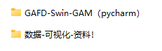
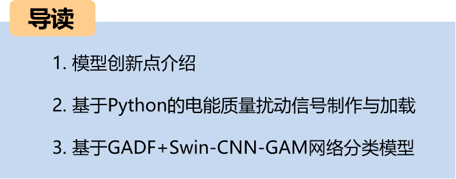
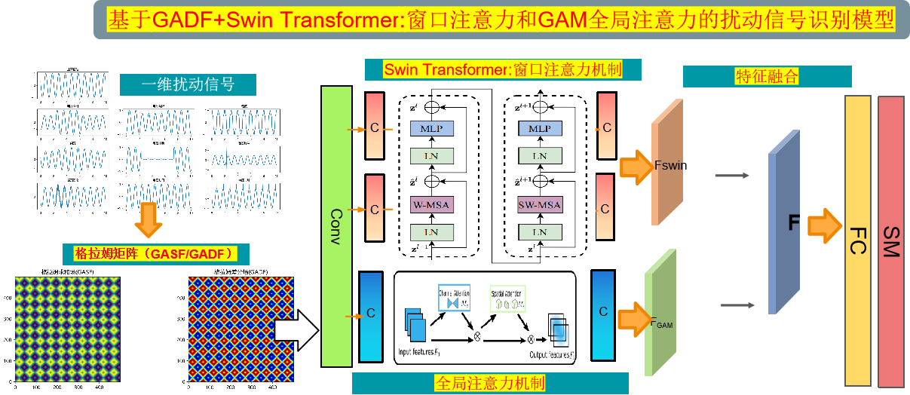

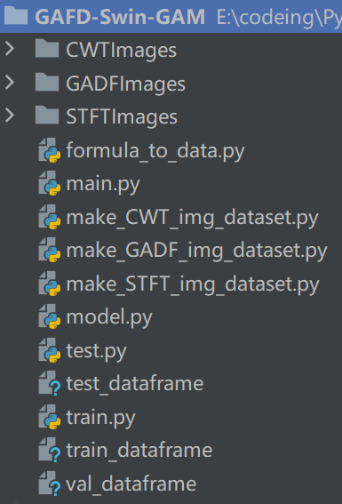
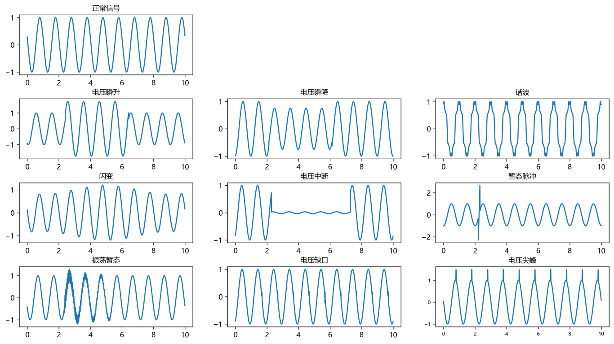
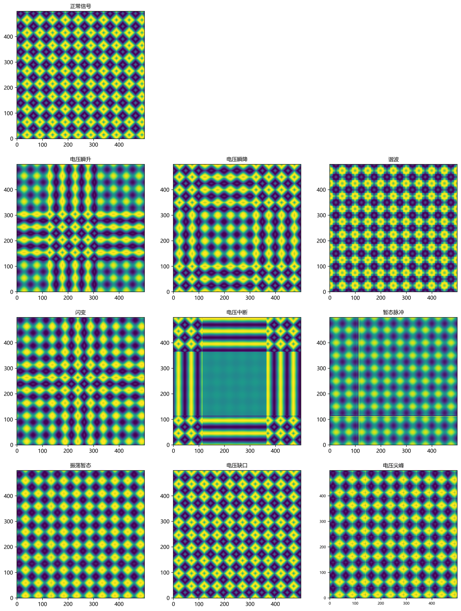
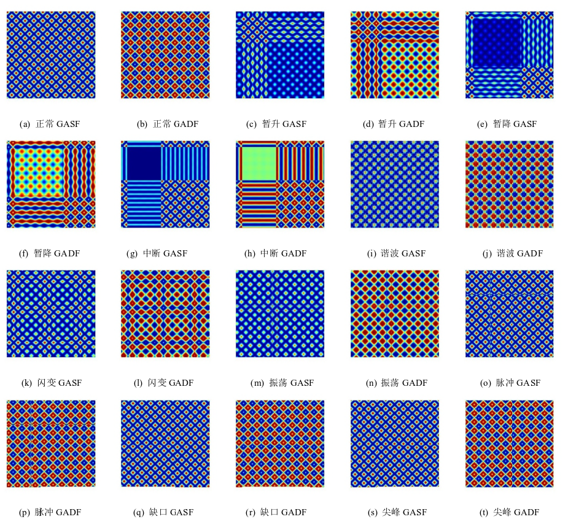
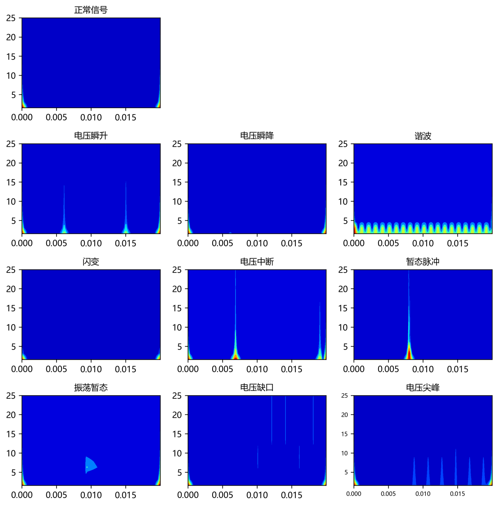
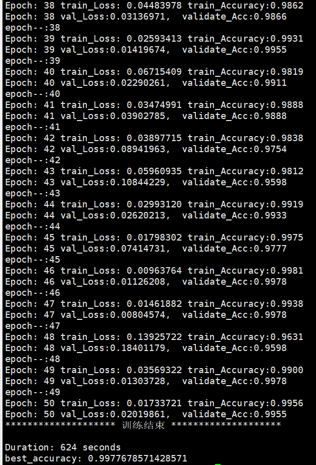
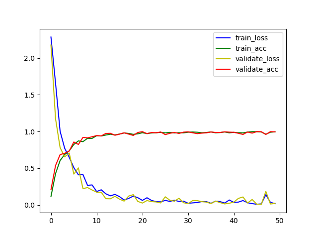

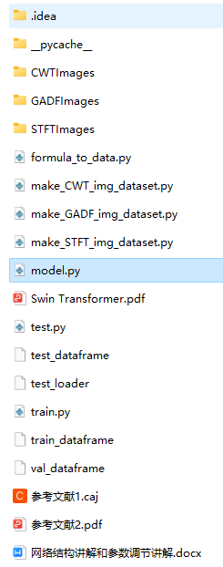

<!-- PAYMENT_BLOCK -->

## Get this dataset

- Payment link (Stripe): [Buy now](https://buy.stripe.com/3cs8yP7sY87d0vu9AB)
- Payment QR code: 

<!-- /PAYMENT_BLOCK -->
